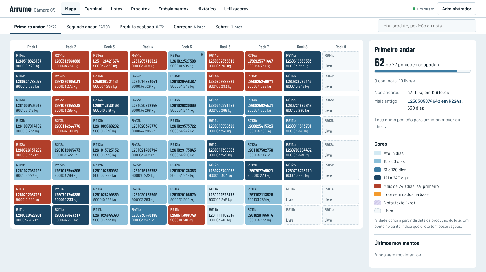
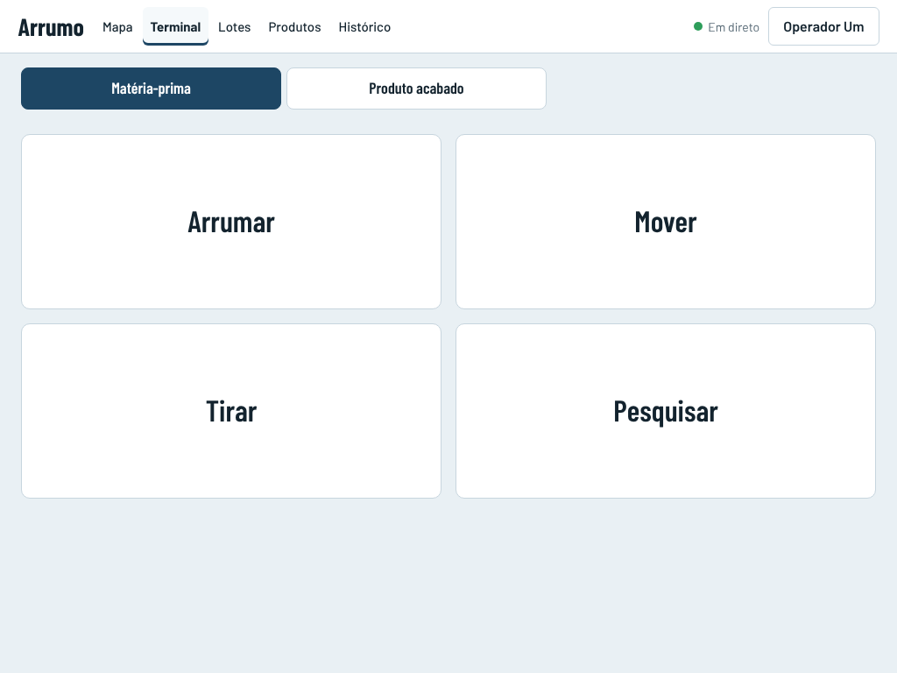
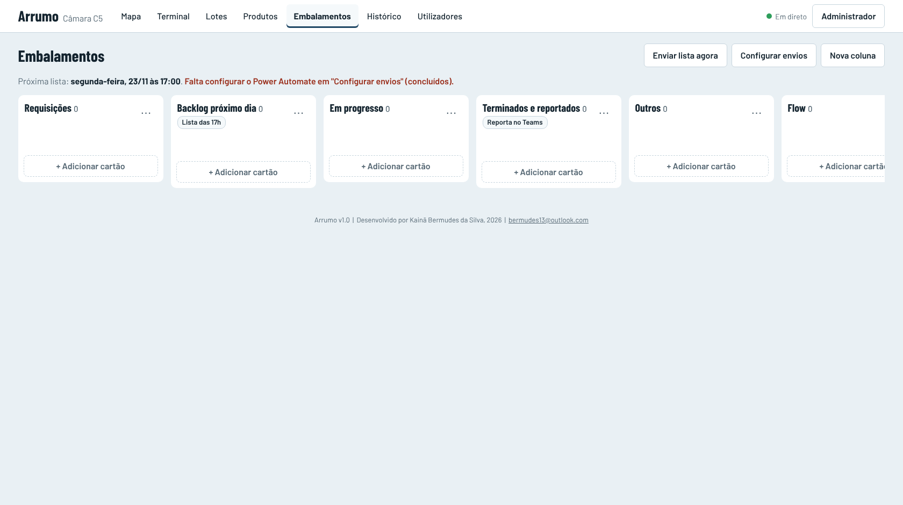
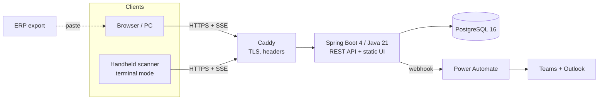

# Arrumo

**Real-time warehouse map for a frozen-goods cold room** — lots, pallets, FIFO/FEFO and packaging planning, used on the shop floor by several people at once.

[](https://github.com/devmeester/arrumo/actions/workflows/ci.yml)
  



## The problem

I am a production supervisor at a codfish processing plant in Portugal and I run the frozen-goods division. Our cold room was tracked with a single-user desktop app backed by an Excel file, plus a Trello board for the daily packaging plan:

- only one person could update the map at a time, and the Excel copy was often out of date;
- finding the oldest lot (FIFO) meant reading the whole sheet;
- the ERP knew *what* was in stock, but not *where* it was in the room;
- the packaging list for the next day was copied by hand into emails and Teams.

Arrumo replaces all of that with one web app.

## What it does

| | |
|---|---|
| **Live map** | Raw-material room (9 racks × 2 floors, 2–3 lots per position: R514a, R521c) and finished-goods racks (9 racks × 2 levels × 4 pallets). Every change appears on every screen instantly (Server-Sent Events). |
| **FIFO / FEFO colours** | Raw material is coloured by lot age (production date read from the lot code); finished goods by days to expiry. The oldest lot is one click away. |
| **Scanner-first input** | Type or scan a lot into a position. GS1-128 pallet labels (SSCC, GTIN, batch, expiry, net weight) are parsed automatically. |
| **ERP import** | Paste the ERP stock export (tab-separated). The app creates/updates lots and products, and lists lots that are in the app but no longer in the ERP so they can be checked out in one click. |
| **Terminal mode** | A big-button screen for handheld scanners and the 1024×768 shop-floor terminal: store, move, remove and search, split into raw material / finished goods tabs. |
| **Packaging board** | Kanban that replaced Trello. At 17:00 (Mon–Fri) the next-day list is sent to Teams and e-mail through Power Automate; finished jobs are reported to Teams. |
| **Full history** | Every movement and every admin action is stored in append-only tables. |

<p>
  
  
</p>

## Architecture



- **Backend:** Spring Boot 4 (Web MVC, Security, Data JPA, Validation), Flyway migrations, virtual threads.
- **Frontend:** plain HTML/CSS/JavaScript, no framework and no build step — it has to run on old shop-floor PCs and Android scanners.
- **Deploy:** Docker Compose (app + PostgreSQL on an internal network + Caddy for automatic HTTPS), encrypted backups with restic.

## Engineering decisions I care about

**Concurrency.** Several people edit the same map. Every write locks the affected rows (`SELECT … FOR UPDATE`, always in the same order to avoid deadlocks) and checks the version the user was looking at; if someone else changed it first, the user gets a clear *409 — someone else changed this* instead of a silent overwrite. Unique constraints (`DEFERRABLE`) guarantee a lot or pallet can never be in two places.

**Security.**
- Passwords with BCrypt, mandatory TOTP 2FA (RFC 6238) for admins and managers, account lockout and per-IP rate limiting.
- Session cookie `HttpOnly; Secure; SameSite=Strict`, CSRF tokens, strict Content-Security-Policy (no inline scripts), HSTS.
- 2FA secrets and webhook URLs encrypted at rest with AES-256-GCM.
- Sessions are invalidated when the password, role or 2FA changes.
- Role-based access checked on the server: logistics users only receive finished-goods map data and events.
- History and audit tables are append-only, enforced by database triggers.

**Real time without a message broker.** Changes are published *after commit* (`@TransactionalEventListener`) to SSE connections, filtered per user role. One small server is enough for the whole plant.

**Domain parsing.** GS1-128 parser (AI 00, 01/02, 10, 11, 15/17, 310n, 37, FNC1 separators, symbology prefixes) and a tolerant parser for the ERP's mixed number formats (`1,500.5 KG`, `0.76 (CX); 3.8 (KG)`).

## Run it locally

Deploying to a VPS: see [START.md](START.md).

Requirements: Java 21, Maven, Docker (for PostgreSQL).

```bash
docker run -d --name arrumo-db -p 5432:5432 \
  -e POSTGRES_USER=arrumo -e POSTGRES_PASSWORD=arrumo -e POSTGRES_DB=arrumo postgres:16
cd backend
mvn spring-boot:run -Dspring-boot.run.profiles=dev
```

Open http://localhost:8080 and sign in with `admin` / `change-me-now-2026` (dev profile only — you will be asked to change it). The dev profile loads demo data; all lot and product codes in it are made up.

Configuration, production deployment (VPS or Railway, Docker Compose, HTTPS, backups) and the Power Automate setup are described in the [manual](docs/MANUAL.md).

## Project layout

```
backend/
  src/main/java/pt/arrumo/
    map/           map, locations, pallets, GS1 parser
    management/    lots, products, users, history, ERP import
    packing/       packing board, Power Automate notifications, 17:00 scheduler
    security/      login flow, TOTP, encryption, session checks, audit
    events/        real-time changes over SSE
    domain/        JPA entities and repositories
    config/, errors/
  src/main/resources/
    db/migration/  Flyway migrations (V1 schema and triggers, V2 layout)
    db/demo/       anonymised demo data (dev profile only)
    static/        UI (index.html, app.js, app.css)
deploy/            docker-compose, Caddyfile, backup script
docs/              manual, screenshots
```

Code, API, database and docs are in English. The user interface is in Portuguese, the language of the people who use it every day.

## Roadmap

- Integration tests with Testcontainers (PostgreSQL) for the locking and permission rules
- Shared-terminal mode: quick badge/PIN switch between operators and auto-logout
- Separate database roles for migrations and runtime
- Printable barcode labels for rack positions
- Expiry alerts and stock-count (inventory) mode

---

Kainã Bermudes da Silva · [LinkedIn](https://linkedin.com/in/kainabermudes) · bermudes13@outlook.com
